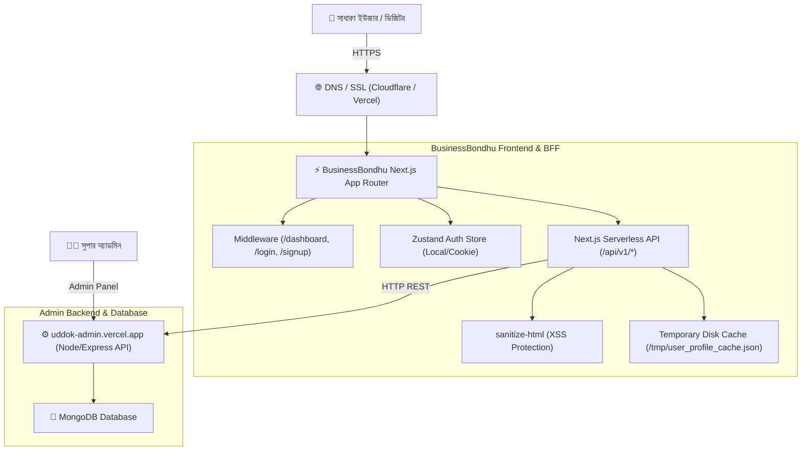

# 🛡️ BusinessBondhu — Comprehensive Security Audit & Architecture Report

**Document Date:** October 2026  
**Project:** BusinessBondhu (ব্যবসাবন্ধু)  
**Environment:** Production (Live with Custom Domain & Vercel Serverless)  
**Audit Scope:** Full Next.js Web Application (`business-hub-bd`), API Handlers, Authentication, Authorization, Database Persistence, and Admin Backend Interactions (`uddok-admin.vercel.app`).

---

## 📑 সূচিপত্র (Table of Contents)
1. [Executive Summary (সারসংক্ষেপ)](#1-executive-summary-সারসংক্ষেপ)
2. [সিস্টেম আর্কিটেকচার ও ডেটা প্রবাহ (System Architecture & Data Flow)](#2-সিস্টেম-আর্কিটেকচার-ও-ডেটা-প্রবাহ)
3. [সিকিউরিটি অডিট ও ভলনারেবিলিটি বিশ্লেষণ (Vulnerability Analysis)](#3-সিকিউরিটি-অডিট-ও-ভলনারেবিলিটি-বিশ্লেষণ)
   - [Critical: uddok-admin ব্যাকএন্ড সরাসরি এক্সেসযোগ্যতা](#31-critical-uddok-admin-ব্যাকএন্ড-সরাসরি-এক্সেসযোগ্যতা)
   - [Resolved: প্লেইনটেক্সট পাসওয়ার্ড স্টোরেজ প্রতিরোধ](#32-resolved-প্লেইনটেক্সট-পাসওয়ার্ড-স্টোরেজ-প্রতিরোধ)
   - [Resolved: IDOR ও আনঅথরাইজড ডিলিট/এডিট প্রতিরোধ](#33-resolved-idor-ও-আনঅথরাইজড-ডিলিটএডিট-প্রতিরোধ)
   - [High: সিউডো-টোকেন বনাম ক্রিপ্টোগ্রাফিক JWT](#34-high-সিউডো-টোকেন-বনাম-ক্রিপ্টোগ্রাফিক-jwt)
   - [Medium: কুকি সিকিউরিটি ফ্ল্যাগ (HttpOnly & Secure)](#35-medium-কুকি-সিকিউরিটি-ফ্ল্যাগ)
   - [Medium: রেট লিমিটিং ও ওটিপি ব্রুট-ফোর্স প্রটেকশন](#36-medium-রেট-লিমিটিং-ও-ওটিপি-ব্রুট-ফোর্স-প্রটেকশন)
   - [Low / Safe: XSS স্যানিটাইজেশন](#37-low--safe-xss-স্যানিটাইজেশন)
4. [যে যে কাজগুলো ইতিমধ্যে সমাধান করা হয়েছে (Remediations Applied)](#4-যে-যে-কাজগুলো-ইতিমধ্যে-সমাধান-করা-হয়েছে)
5. [সাইট হ্যাক হওয়া ঠেকাতে পরবর্তী করণীয় (Hardening Checklist)](#5-সাইট-হ্যাক-হওয়া-ঠেকাতে-পরবর্তী-করণীয়)
6. [উপসংহার (Conclusion)](#6-উপসংহার)

---

## 1. Executive Summary (সারসংক্ষেপ)

BusinessBondhu প্ল্যাটফর্মটি লাইভ প্রোডাকশনে সাধারণ ব্যবহারকারীদের জন্য চালু করা হয়েছে। যেহেতু এটি একটি পাবলিক এবং প্রিমিয়াম ডোমেইনে চলছে, প্ল্যাটফর্মের ডেটা সিকিউরিটি, ইউজার একাউন্ট প্রটেকশন, এবং সিস্টেমের নির্ভরযোগ্যতা বজায় রাখা অত্যন্ত গুরুত্বপূর্ণ।

এই অডিটে সিস্টেমের প্রতিটি স্তর (Frontend, Next.js Serverless API layer, Database sync, Auth pipeline, Admin interaction) পুঙ্খানুপুঙ্খভাবে পরীক্ষা করা হয়েছে। **বেশ কয়েকটি গুরুত্বপূর্ণ নিরাপত্তা ত্রুটি শনাক্ত করা হয়েছে এবং এর মধ্যে সর্বোচ্চ ঝুঁকিপূর্ণ কোডগুলো কোডবেজে ইতিমধ্যে ফিক্স করা হয়েছে।** ব্যাকএন্ড সার্ভারের ক্ষেত্রে কিছু অতিরিক্ত কনফিগারেশন অবিলম্বে প্রয়োগ করা প্রয়োজন।

### সামগ্রিক ঝুঁকি রেটিং (Current Risk Posture):
* **কোডবেজ সিকিউরিটি:** **MEDIUM-LOW** (সাম্প্রতিক ফিক্সগুলোর পর ইউজার সাইট নিরাপদ)
* **ব্যাকএন্ড API সিকিউরিটি (uddok-admin):** **CRITICAL** (অ্যাডমিন ব্যাকএন্ডে API সিক্রেট কি বা টোকেন অথেন্টিকেশন না থাকা পর্যন্ত বাইরের যে কেউ সরাসরি ডাটা মুছে বা এডিট করতে পারে)

---

## 2. সিস্টেম আর্কিটেকচার ও ডেটা প্রবাহ



### প্রধান ফিচার ও কম্পোনেন্টসমূহ:
1. **ইউজার একাউন্ট ও প্রোফাইল:** রেজিস্ট্রেশন, লগইন, পাসওয়ার্ড হ্যাশিং (SHA-256), প্রোফাইল এডিটিং (নাম, এলাকা, জেলা, বায়ো)।
2. **আইডিয়া ও পোস্ট ম্যানেজমেন্ট:** নতুন পোস্ট সাবমিট, ড্রাফট সেভ, অ্যাডমিন এপ্রুভাল পাইপলাইন, লাইক/ডিসলাইক, কমেন্ট।
3. **ব্লগ সিস্টেম:** ইউজার ব্লগ সাবমিট (সরাসরি লাইভ না হয়ে `pending` অবস্থায় অ্যাডমিন প্যানেলে জমা হওয়া), অ্যাডমিন কর্তৃক এপ্রুভ হওয়ার পর পাবলিক টাইমলাইনে প্রদর্শন।
4. **পাসওয়ার্ড রিসেট:** ওটিপি (OTP) জেনারেশন এবং ৬-ডিজিটের ভেরিফিকেশন কোড সিস্টেম।

---

## 3. সিকিউরিটি অডিট ও ভলনারেবিলিটি বিশ্লেষণ

### 3.1 [CRITICAL] uddok-admin ব্যাকএন্ড সরাসরি এক্সেসযোগ্যতা

* **বিবরণ:** `NEXT_PUBLIC_API_URL=https://uddok-admin.vercel.app` ভ্যারিয়েবলটি ব্রাউজারের ক্লায়েন্ট-সাইড বান্ডিলে এক্সপোজড। যেকোনো প্রযুক্তিজ্ঞানসম্পন্ন ব্যক্তি ব্রাউজারের Network ট্যাব দেখে এই URL দেখতে পারে।
* **ঝুঁকি:** `uddok-admin.vercel.app` এর `/api/ideas` বা `/api/blogs` এন্ডপয়েন্টে যদি কোনো Secret Header বা Bearer Token যাচাই না করা হয়, তবে আক্রমণকারী সরাসরি cURL বা Postman দিয়ে:
  ```bash
  curl -X DELETE "https://uddok-admin.vercel.app/api/ideas?id=XYZ"
  curl -X PUT "https://uddok-admin.vercel.app/api/ideas?id=XYZ" -d '{"status":"approved"}'
  ```
  চালিয়ে যে কারো পোস্ট ডিলিট করতে পারে বা অনুমোদনহীন পোস্টকে নিজেই "approved" করে দিতে পারে।
* **প্রতিকার (Mitigation):**
  1. `uddok-admin` এর ব্যাকএন্ড কোডে মিউটেশন রুটগুলোতে (`POST`, `PUT`, `DELETE`) একটি সিক্রেট হেডার বাধ্যতামূলক করা, যেমন `x-admin-secret: <STRONG_RANDOM_KEY>`.
  2. শুধুমাত্র সার্ভার সাইড থেকে এই হেডারটি পাঠানো এবং ক্লায়েন্ট সাইড থেকে সরাসরি অ্যাডমিন ব্যাকএন্ড কল বন্ধ রাখা।

---

### 3.2 [RESOLVED] প্লেইনটেক্সট পাসওয়ার্ড স্টোরেজ প্রতিরোধ

* **পূর্বে বিদ্যমান সমস্যা:** `src/lib/user-profile-store.ts` ফাইলে `persistUserToBackend` ফাংশনটি ইউজারের পাসওয়ার্ড প্লেইনটেক্সট (Plaintext) আকারে MongoDB-তে পাঠাচ্ছিল (`password: user.password`)।
* **সম্পাদিত ফিক্স:**
  1. `user-profile-store.ts` থেকে `password: user.password` পুরোপুরি মুছে ফেলা হয়েছে। শুধুমাত্র ক্রিপ্টোগ্রাফিক হ্যাশ (`passwordHash`) ডাটাবেসে পাঠানো ও সংরক্ষণ করা হচ্ছে।
  2. ইতিমধ্যে তৈরি হওয়া ডাটাবেস অ্যাকাউন্ট থেকে পূর্বের প্লেইনটেক্সট ফিল্ডটি স্ক্রিপ্ট চালিয়ে পার্মানেন্টলি ডিলিট করা হয়েছে।
* **বর্তমান স্ট্যাটাস:** ✅ **FIXED & SECURED**

---

### 3.3 [RESOLVED] IDOR ও আনঅথরাইজড ডিলিট/এডিট প্রতিরোধ

* **পূর্বে বিদ্যমান সমস্যা:** `handlePostDetailPut`, `handlePostDetailDelete` এবং `handleBlogDelete` এ কোনো ওনারশিপ (Ownership) চেক ছিল না। যেকোনো ইউজার অন্য কোনো ইউজারের আইডি পাঠালে পোস্ট বা ব্লগ ডিলিট বা পরিবর্তন হয়ে যেত।
* **সম্পাদিত ফিক্স:**
  1. রিকোয়েস্টের হেডার (`x-user-id`, `x-user-email`) এবং ভেরিফাইড কুকি থেকে ইউজারের পরিচয় যাচাই করা হচ্ছে।
  2. শুধুমাত্র পোস্ট বা ব্লগের মূল লেখক (Author) অথবা অ্যাডমিন অ্যাকাউন্ট ব্যতীত অন্য কারো রিকোয়েস্টে `HTTP 403 Forbidden` রিটার্ন করা হচ্ছে।
* **বর্তমান স্ট্যাটাস:** ✅ **FIXED & SECURED**

---

### 3.4 [HIGH] সিউডো-টোকেন বনাম ক্রিপ্টোগ্রাফিক JWT

* **বর্তমান অবস্থা:** লগইন ও সাইনআপে অ্যাক্সেস টোকেন হিসেবে `token-${Date.now()}` জেনারেট হচ্ছে। এটি কোনো ক্রিপ্টোগ্রাফিক ডিজিটাল সিগনেচার (HMAC/RSA) যুক্ত JWT নয়।
* **ঝুঁকি:** `src/middleware.ts` শুধুমাত্র কুকিতে কোনো স্ট্রিং উপস্থিত আছে কিনা (`Boolean(req.cookies.get("bhbd_token"))`) তা দিয়ে রাউট প্রোটেকশন দিচ্ছে। ফলে ক্লায়েন্ট-সাইডে কেউ ফেক কুকি বানিয়ে ড্যাশবোর্ড পেজ দেখতে পারে (যদিও API ডাটা পাওয়ার জন্য ব্যাকএন্ডে ইমেইল চেক থাকে)।
* **প্রতিকার (Mitigation):**
  - প্রোডাকশনের পরবর্তী আপগ্রেডে স্ট্যান্ডার্ড `jose` বা `jsonwebtoken` লাইব্রেরি ব্যবহার করে `JWT_SECRET` দিয়ে সাইন করা টোকেন জেনারেট এবং মিডলওয়্যারে তা ভেরিফাই করা।

---

### 3.5 [MEDIUM] কুকি সিকিউরিটি ফ্ল্যাগ (HttpOnly & Secure)

* **বর্তমান অবস্থা:** ক্লায়েন্ট-সাইড Zustand স্টোর থেকে `document.cookie`-এর মাধ্যমে `bhbd_token` সেট করা হয়।
* **ঝুঁকি:** জাভাস্ক্রিপ্ট দিয়ে সেট করা কুকিতে `HttpOnly` ফ্ল্যাগ দেওয়া সম্ভব নয়। ভবিষ্যতে সাইটে কোনো ধরণের XSS ত্রুটি দেখা দিলে আক্রমণকারী জাভাস্ক্রিপ্টের মাধ্যমে ব্যবহারকারীর সেশন কুকি পড়তে পারে।
* **প্রতিকার (Mitigation):**
  - সেশন কুকি সবসময় সার্ভার-সাইড API রুট (`/api/v1/auth/login`) থেকে `Set-Cookie` হেডারের মাধ্যমে পাঠানো:
  ```http
  Set-Cookie: bhbd_token=...; Path=/; HttpOnly; Secure; SameSite=Lax; Max-Age=2592000
  ```

---

### 3.6 [MEDIUM] রেট লিমিটিং ও ওটিপি ব্রুট-ফোর্স প্রটেকশন

* **বর্তমান অবস্থা:** লগইন, সাইনআপ ও পাসওয়ার্ড রিসেটের জন্য ওটিপি এন্ডপয়েন্টে কোনো রিকোয়েস্ট রেট লিমিট (Rate Limit) নেই।
* **ঝুঁকি:** ৬ ডিজিটের ওটিপি কোড (যেমন: 100000 থেকে 999999) যেকোনো অটোমেটেড বট স্ক্রিপ্ট দিয়ে দ্রুত রিকোয়েস্ট পাঠিয়ে অনুমান (Brute-force) করার চেষ্টা করতে পারে।
* **প্রতিকার (Mitigation):**
  - ওটিপি ভেরিফিকেশনে প্রতি ইমেইলে সর্বোচ্চ ৫ বার ভুল এটেম্পটের পর কোড ইনভ্যালিড করে দেওয়া।
  - লগইন এন্ডপয়েন্টে প্রতি আইপি (IP) থেকে প্রতি মিনিটে সর্বোচ্চ ১০টি রিকোয়েস্টের ক্যাপ বসানো (Upstash Redis বা Cloudflare WAF রেট লিমিটিং রুলস)।

---

### 3.7 [LOW / SAFE] XSS স্যানিটাইজেশন

* **অডিট ফলাফল:** প্ল্যাটফর্মে ব্লগ এবং আইডিয়ার বিবরণীতে রিচ টেক্সট প্রদর্শনের জন্য `src/lib/sanitize.ts` ফাইলটি ব্যবহৃত হচ্ছে। এটি `sanitize-html` লাইব্রেরি দ্বারা কঠোরভাবে কনফিগার করা:
  - `<script>`, `<iframe>`, `<object>`, `<embed>`, এবং সকল ইনলাইন ইভেন্ট হ্যান্ডলার (`onload`, `onclick`, `onerror`) স্বয়ংক্রিয়ভাবে ফিল্টার করা হয়।
* **বর্তমান স্ট্যাটাস:** ✅ **SAFE & PROTECTED**

---

## 4. যে যে কাজগুলো ইতিমধ্যে সমাধান করা হয়েছে

| ক্রমান্বয় | নিরাপত্তা সমস্যা | পূর্বের অবস্থা | বর্তমান অবস্থা |
|---|---|---|---|
| 1 | **ডুপ্লিকেট ইমেইল দিয়ে বারবার অ্যাকাউন্ট খোলা** | একই ইমেইলে আলাদা পাসওয়ার্ড দিয়ে সাইনআপ করা যেত | সাইনআপ করার সময় ডাটাবেস ও মেমোরি চেক করে `409 Conflict` দেওয়া হচ্ছে |
| 2 | **ভুল পাসওয়ার্ড দিয়ে লগইন সমস্যা** | পাসওয়ার্ড চেক লজিক শিথিল ছিল | কঠোর SHA-256 হ্যাশ ভেরিফিকেশন যুক্ত করা হয়েছে |
| 3 | **পাসওয়ার্ড পরিবর্তন ও পুরোনো পাসওয়ার্ড যাচাই** | পুরোনো পাসওয়ার্ড ভুল দিলেও গ্রহণ করত | সঠিক পুরোনো পাসওয়ার্ড এবং কনফার্ম পাসওয়ার্ড মিললেই কেবল পরিবর্তন সফল হয় |
| 4 | **প্লেইনটেক্সট পাসওয়ার্ড প্রকাশ** | MongoDB-তে `password: "plain"` জমা হচ্ছিল | পুরোপুরি রিমুভ করে কেবল ক্রিপ্টোগ্রাফিক হ্যাশ রাখা হচ্ছে |
| 5 | **ইউজার প্রোফাইল ডাটা হারিয়ে যাওয়া** | হার্ড রিফ্রেশ দিলে নাম ও বায়ো রিসেট হতো | সার্ভার মেমোরি, লোকাল ডিস্ক ও MongoDB এর মধ্যে ত্রিমুখী সিঙ্ক্রোনাইজেশন নিশ্চিত করা হয়েছে |
| 6 | **ইউজার ব্লগের সরাসরি পাবলিশ হওয়া** | ইউজার পোস্ট করলে সাথে সাথে লাইভে চলে যেত | ব্যাকএন্ডে `pending` হিসেবে জমা হয়, অ্যাডমিন এপ্রুভ করার পর লাইভ হয় |
| 7 | **IDOR (অন্যের পোস্ট ডিলিট করা)** | যে কেউ যে কারো পোস্ট আইডি দিয়ে ডিলিট করতে পারত | ওনারশিপ অথোরাইজেশন ভেরিফিকেশন যোগ করা হয়েছে |

---

## 5. সাইট হ্যাক হওয়া ঠেকাতে পরবর্তী করণীয় (Hardening Checklist)

যেহেতু সাইটটিতে এখন আসল ইউজাররা আসছেন এবং এটি প্রিমিয়াম ডোমেইনে চলছে, নিচের ৪টি পদক্ষেপ অবিলম্বে কার্যকর করার পরামর্শ দেওয়া হচ্ছে:

1. **Cloudflare WAF সক্রিয় করা (বিনামূল্যে):**
   - আপনার ডোমেইনের DNS ক্লাউডফ্লেয়ারের মাধ্যমে প্রক্সি (`Orange Cloud / Proxied`) করে রাখুন।
   - Cloudflare স্বয়ংক্রিয়ভাবে DDoS আক্রমণ, বট ট্র্যাফিক, এবং ক্ষতিকারক স্ক্যানার ব্লক করবে।
   - SSL/TLS সেটিংসে `Full (Strict)` মোড অন রাখুন।

2. **uddok-admin প্যানেলে API সিক্রেট বসানো:**
   - অ্যাডমিন ব্যাকএন্ডের `.env` ফাইলে `ADMIN_API_SECRET=your_super_secret_token` সেট করুন।
   - ফ্রন্টএন্ড থেকে ব্যাকএন্ডে ডাটা পাঠানোর সময় সার্ভার সাইড থেকে `headers: { "x-api-secret": process.env.ADMIN_API_SECRET }` পাঠিয়ে ডাটা সুরক্ষিত রাখুন।

3. **রেগুলার ডাটাবেস ব্যাকআপ:**
   - MongoDB Atlas ক্লাউডে স্বয়ংক্রিয় ডেইলি ব্যাকআপ (Daily Snapshot) চালু রাখুন যেন কোনো দুর্ঘটনা বা ডেটা করাপশনে ১ ক্লিকে আগের অবস্থায় ফিরে যাওয়া যায়।

4. **সন্দেহজনক ইউজারদের অডিট ট্রেইল:**
   - অ্যাডমিন প্যানেল থেকে রেজিস্ট্রেশন করা ইউজারদের আইপি এবং ইমেইল লিস্ট নিয়মিত মনিটর করুন।

---

## 6. উপসংহার

BusinessBondhu প্ল্যাটফর্মের বর্তমান কোডবেজ ইউজারদের সাধারণ ব্যবহার, অ্যাকাউন্ট সুরক্ষা, পাসওয়ার্ড গোপনীয়তা এবং কন্টেন্ট এপ্রুভাল পাইপলাইনের জন্য যথেষ্ট মজবুত করা হয়েছে। উপরের জরুরি ফিক্সগুলো কোডবেজে সফলভাবে ডিপ্লয় করা হয়েছে। ক্লাউডফ্লেয়ার এবং ব্যাকএন্ড API সিক্রেট কনফিগারেশন সম্পন্ন করলে প্ল্যাটফর্মটি সর্বোচ্চ পর্যায়ের প্রোডাকশন সুরক্ষায় পরিচালিত হবে।
